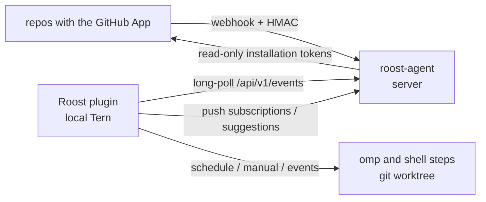

# Roost

[简体中文](README.zh-CN.md)

Roost is a Tern plugin that runs fixed omp workflows **on your machine**. You create and edit automations the way grok.com/automations does it: pick **New automation** in the console, or start from a template. A form takes the triggers and the instructions, and the automation is live once you save. Triggers:

- **Schedules**: once, hourly, daily, weekly, monthly, yearly, or a custom cron expression. The plugin schedules them locally, so no server is needed. Manual runs from the console also work, with inputs.
- **GitHub events**: PR opened, pushed or merged, comments, reviews, labels, branch pushes, CI finished, and more. GitHub can't reach a laptop, so a small relay, `roost-agent` (Rust), runs on a server as a **GitHub App**. It verifies the webhooks of the repositories the App is installed on, keeps the subscribed ones, and hands them to the plugin's long-poll.

`roost-agent` runs no workflows and is not an AI runtime; it only relays events.



## Plugin

Install with `tern plugin install …` (or `tern plugin link .` while developing) and run **Roost:打开工作台** from the palette. The plugin's data directory holds:

| File | Purpose |
|---|---|
| `roost.toml` | Local binding: relay URL and token, runner settings, optional `[github] login` |
| `workflows.toml` | Repos (GitHub name → local path), automations, triggers, steps; the editor reads and writes it |
| `theme.css` (optional) | Your styles, applied live |

The editor writes back only the edited `[[workflow]]` block. Comments and the rest of the file stay as they were, and the previous file is kept as `workflows.toml.bak`. See [README.zh-CN.md](README.zh-CN.md) for the full reference: schedule kinds, GitHub trigger kinds and their filters, templates, `ROOST_*` environment, workspaces and safety defaults.

Highlights:
- Each GitHub trigger kind offers the filters Grok's does: repositories (`owner/*` works), authors (`@me` is you), assignees, branches, labels, conclusions, review states, and toggles for drafts, bots and your own activity. A trigger needs at least one filter.
- Templates apply to omp prompts only; shell steps read `ROOST_*` environment variables, so event text never lands in a command line.
- Event runs for repos declared with a local path use a temporary git worktree at the event's ref, removed afterwards. Other repos run in an empty temporary directory.
- omp steps run as native Tern agent blocks in a fixed session (`[runner] session`, default `Roost`). With `notify` on (the default), a toast reports how each run ended.
- User-content events only fire for `OWNER`/`MEMBER`/`COLLABORATOR` authors unless a trigger sets `associations = ["*"]`. CI events whose code comes from a fork only fire with `forks = true`.

## Relay agent

```sh
cd agent && cargo build --release
roost-agent check --config /etc/roost/agent.toml
roost-agent serve --config /etc/roost/agent.toml
```

Start from `agent/deploy/agent.example.toml` and `agent/deploy/roost-agent.service`. `server.public_url` is required: GitHub uses it for the registration callback and for webhooks.

Creating the GitHub App:

1. Press **创建 GitHub App** on the console's relay page. For an organization, enter its name first.
2. A page on the agent posts the App manifest to GitHub. Confirm the name there and create the App.
3. GitHub calls the agent back. The agent stores the App id, private key and webhook secret in `<data>/github-app.json` (mode 600), then sends you to the installation page, where you pick repositories.

The App is read-only (metadata, contents, issues, pull_requests, checks, actions). Write actions such as comments and pushes stay with your local `gh` in omp or shell steps.

Sync model: the plugin computes per-repo event subscriptions from `workflows.toml` (`"*"` for triggers on any repo) and pushes them (`PUT /api/v1/subscriptions`, revision-checked). When the push fails, the console shows the exact `subscriptions.toml` to place on the server; press **Reload** after placing it. **Restart** re-execs the agent in place after an `agent.toml` or binary change. Stored events and cursors survive the restart.

API:

- `POST /hooks/github`, signed with the App's webhook secret.
- Registration pages: `GET /github/app/new|callback|installed`.
- Bearer-authenticated:
  - `GET /api/v1/events?after=&wait=` (long-poll)
  - `GET|PUT /api/v1/subscriptions`
  - `POST /api/v1/reload`, `POST /api/v1/restart`
  - `POST /api/v1/github/app/manifest`, `DELETE /api/v1/github/app`
  - `GET /api/v1/github/{repos,people,labels,branches,workflows}?repo=`
  - `POST /api/v1/events/test`
  - `GET /api/v1/status`, `GET /api/v1/deliveries`
- Unauthenticated: `GET /healthz`.

## Development

```sh
scripts/check.sh   # luau-lsp strict, Luau tests, cargo fmt/clippy/test, memory budget
```
