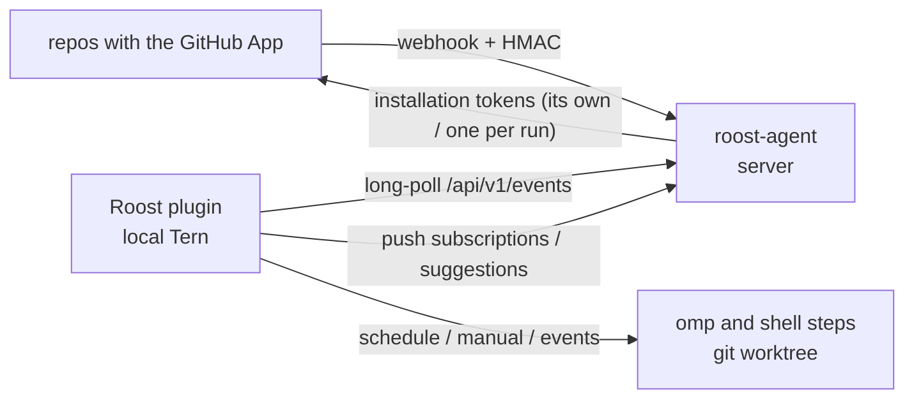

# Roost

[简体中文](README.zh-CN.md)

Roost is a Tern plugin that runs fixed omp workflows **on your machine**. You create and edit automations the way grok.com/automations does it: pick **New automation** in the console, or start from a template. A form takes the triggers and the instructions, and the automation is live once you save. Triggers:

- **Schedules**: once, hourly, daily, weekly, monthly, yearly, or a custom cron expression. The plugin schedules them locally, so no server is needed. Manual runs from the console also work, with inputs.
- **GitHub events**: PR opened, pushed or merged, comments, reviews, labels, branch pushes, CI finished, and more. GitHub can't reach a laptop, so a small relay, `roost-agent` (Rust), runs on a server as a **GitHub App**. It verifies the webhooks of the repositories the App is installed on, keeps the subscribed ones, and hands them to the plugin's long-poll.

`roost-agent` runs no workflows and is not an AI runtime; it only relays events.



## Plugin

Install with `tern plugin install …` (or `tern plugin link .` while developing) and run **Roost:打开工作台** from the palette. The plugin's data directory holds:

| File | Purpose |
|---|---|
| `roost.toml` | Local binding: relay URL and token, runner settings, `[retention]`, optional `[github] login` |
| `workflows.toml` | Repos (GitHub name → local path), automations, triggers, steps; the editor reads and writes it |
| `runs.json`, `runs/<id>/`, `worktrees/<id>/` | Run history; each run's log, event payload and omp sessions; event worktrees |
| `events.json` | The events page: each relayed event and the runs it started (or why none) |
| `groups.json` | The workflows page's groups: names, order, folded or not, and which workflow is in which (display only). Exports carry groups by name: one workflow brings its group; exporting all writes workflows in page order with every group, empty ones too. Importing merges same-named groups, adds missing ones, and leaves workflows already grouped here where they are |
| `tabs/` | Tab operations queued for windows (`ops/`) and the tabs Roost opened (`open/<workflow>.<key>.json`) |
| `revisions.json`, `revisions/<n>/` | Evolvers' revisions and their before/after snapshots (latest 100) |
| `upgrades/<run>.json`, `upgrade/`, `boot.txt` | Self-upgrade outcomes, logs and per-run apply scripts, and the marker a loaded host writes |
| `theme.css` (optional) | Your styles, applied live |

The editor writes back only the edited `[[workflow]]` block. Comments and the rest of the file stay as they were, and the previous file is kept as `workflows.toml.bak`. See [README.zh-CN.md](README.zh-CN.md) for the full reference: schedule kinds, GitHub trigger kinds and their filters, templates, `ROOST_*` environment, workspaces and safety defaults.

Highlights:
- Each GitHub trigger kind offers the filters Grok's does: repositories (`owner/*` works), authors (`@me` is you), assignees, branches, labels, conclusions, review states, and toggles for drafts, bots and your own activity. A trigger needs at least one filter.
- Templates apply to omp prompts only; shell steps read `ROOST_*` environment variables, so event text never lands in a command line.
- Environment: shell steps and the local tools the plugin runs (`gh`, `omp`) inherit your login shell's environment, not only the Tern daemon's minimal one. At startup and every 10 minutes the plugin runs your account's login shell (macOS directory record, else `$SHELL`; fish included) as `-l -i -c` and reads its `env -0` between two marks, so what its startup prints is ignored; PWD/OLDPWD/SHLVL/_ are dropped. It is kept in memory only. Precedence: login environment < `[runner] env` < workflow `env` < `ROOST_*`; PATH is `[runner] extra_path` then the login shell's PATH unless an `env` sets PATH. Runs neither start nor advance until the first capture ends (10 s at most); a failed capture is shown as a notice and keeps the last good one (none: the daemon's environment). App-identity shell steps leave the login shell's `GH_TOKEN`/`GITHUB_TOKEN`/`GH_ENTERPRISE_TOKEN`/`GITHUB_ENTERPRISE_TOKEN` out (ones you set in `env` stay); App-identity omp steps, which run in Tern agent blocks started in Tern's login environment, unset the last three before taking the run's `GH_TOKEN`.
- Model select of the prompt step: **Auto** (no `--model`, omp's `default` role), omp's roles as `@<role>` (resolved by omp through `modelRoles`, so changing a role in omp changes the step) and its chat models (`provider/id`), read from the local `omp config get modelRoles` and `omp models --json` (PATH includes `[runner] extra_path`, cached 5 minutes). A value written by hand in `workflows.toml` (e.g. with a `:high` thinking suffix) stays selectable.
- Step outputs: a shell step appends `key=value` lines to `$ROOST_OUTPUT`; later steps read them as `{{out.key}}` in prompts and `ROOST_OUT_<KEY>` in shells. `when = "out.key"` / `"input.name"` (`!` negates) skips a step unless the value is truthy; `stop=<reason>` ends the run as skipped after that step (no toast).
- Cost: when an omp step ends, the usage records in every JSONL of its session dir (subagents included) are summed into the step (`cost`, `tokens`, estimated at omp's list prices) and shown on runs and workflow cards. `daily_budget = 5` (USD) stops a workflow's omp steps from starting once its spend today (local time) reaches the budget; the run ends as skipped.
- Event runs for repos declared with a local path use a temporary git worktree at the event's ref, removed afterwards. Other repos run in an empty temporary directory. Manual runs use the one declared repo the workflow's triggers name (a schedule's `repo`, a GitHub trigger's non-glob `repos`), else the only declared repo; a `worktree`/`repo` workspace with no such repo refuses to start.
- Running a PR workflow by hand on one pull request: a workflow with a PR trigger (PR opened/draft/pushed/merged, review, review comment, review thread) gets a **拉取请求** field in its run form: `owner/name#12`, the PR URL, or just the number when the triggers name a single repo. It's required when every trigger is a PR trigger; otherwise leaving it empty is a plain manual run. The plugin reads the PR with the local `gh api repos/<repo>/pulls/<n>` (PATH includes `[runner] extra_path`; the relay serves no PR reads), builds the same event fields a webhook would (`action = "manual"`) and a `{action, pull_request, repository}` payload, and runs on the PR head (`refs/pull/N/head`). Cancelling the form while the PR is read queues nothing.
- omp steps run as native Tern agent blocks in a fixed session (`[runner] session`, default `Roost`). While the agent works, the run log follows its session file: each note, one line per tool call, failed tool results, then the final answer. With `notify` on (the default), a toast reports how each run ended. A run's facts list the models its omp steps use, one row per model naming each use: the step's own turns, its subagents and side calls such as omp's judge, as its session files show them (read every 20 s while the agent works, finally when it ends); a step that shows none yet lists what its `model` setting runs (no setting: omp's `default` role, looked up with `omp config get modelRoles`). Double-click an omp step in a run's step timeline (or use its row menu, or the detail's **omp 会话** button for the last one) to see its conversation: a running agent's tab is focused, a finished one is resumed with `omp --resume` in a split to the right of the console. **日志文件** opens the run's `log.txt` in a glimpse over the tab: click outside or press Esc to close it, drag its header to keep it.
- The runs page fills the block without scrolling it: the run list and the run's log scroll inside their panes. The list has an ID column (hidden first when narrow; the row menu copies it), and a run's detail leads with its ID, the same name as `runs/<ID>/` on disk, with a **复制 ID** button. The log wraps at the pane's width by default; turn off **自动换行** in a run's detail to keep long lines whole and scroll them sideways inside the log.
- The workflows page shows one card per workflow. A description takes three lines (hover for the whole text), and cards in a row are as tall as the tallest, with the last-run strip at the bottom. **新建分组** creates a group; a card's **分组** menu moves it into a group, back to 未分组, or into a new group; a group's head folds it, moves it up or down, renames or deletes it (two clicks; its workflows become ungrouped). `[` / `]` move the picked card to the previous / next group. Tern has no general drag events, so moving is by menu, buttons and keys. A renamed workflow keeps its group; an unreadable `groups.json` is reported and never overwritten.
- User-content events only fire for `OWNER`/`MEMBER`/`COLLABORATOR` authors unless a trigger sets `associations = ["*"]`. CI events whose code comes from a fork only fire with `forks = true`.
- Retention: `[retention]` in `roost.toml` (`runs = 200`, `run_age = "30d"`, `events = 200`, `event_age = "30d"`; `"0"` turns an age limit off). Cleanup runs at start, hourly and after the policy changes, and only removes finished runs, with their logs, payloads, omp sessions and leftover worktrees. **Config → 存储与清理** shows disk usage and cleans up on demand; a run's detail deletes that run, and the events page clears its list. Every delete takes two clicks.
- The relay page lists the webhooks GitHub sent, counted by outcome, event and repo, including the ignored ones that never reach this machine. It can also clear the relay's event cache and those counters.
- Tab steps (`tab = "open" | "close"`, `key`, optional `command`, `title`, `keep`, `focus`) open and close Tern tabs through a window. Keys belong to the workflow, every opened tab is recorded with its pane and block kind, and a close only closes a recorded pane that is still that block: tabs Roost didn't open are never touched. Without `keep`, a run's tabs close when it ends.
- Self-iteration: a workflow with `evolve = ["*"]` (or ids) may change the others. Its runs get material under `runs/<id>/evolve/` (digest of recent runs, failed log tails, `base/` and editable `edit/` copies of the targets' `[[workflow]]` blocks, files and their private libraries); when such a run succeeds, what `edit/` changed is validated and applied like an editor save and recorded as a revision (`revisions/<n>/before|after`). The touched workflows' next runs are watched: at least two failures and a failure rate 25 points above the one before undo it automatically; five runs or seven days keep it. `roost = "run_failed"` triggers (with `streak`, optional `workflows`) start an evolver when a target fails, at most once per 30 minutes per target and 20 times a day.
- Self-upgrade: an `upgrade = true` step, run in a worktree of a clone of Roost's own repo, checks that the new commits follow the plugin checkout's HEAD and that the checkout is clean, runs `scripts/check.sh` on the commit in a fresh worktree, then hands off to a detached script that fast-forwards the plugin checkout, reloads Roost and waits for the new host's `boot.txt`; a failed reload moves the checkout back (`git reset --keep`). Outcomes land in `upgrades/<run>.json` and are reported on the next start. This is the only place Roost writes its own plugin directory.

## Relay agent

```sh
cd agent && cargo build --release
roost-agent check --config /etc/roost/agent.toml
roost-agent serve --config /etc/roost/agent.toml
```

Start from `agent/deploy/agent.example.toml` and `agent/deploy/roost-agent.service`. `server.public_url` is required: GitHub uses it for the registration callback and for webhooks.

Creating the GitHub App:

1. Press **创建 GitHub App** on the console's relay page. For an organization, enter its name first.
2. A page on the agent posts the App manifest to GitHub. Confirm the name there and create the App.
3. GitHub calls the agent back. The agent stores the App id, private key and webhook secret in `<data>/github-app.json` (mode 600), then sends you to the installation page, where you pick repositories.

The App asks for read and write on actions, checks, contents, deployments, discussions, issues, pull_requests, statuses and workflows, read on metadata, and write on administration. Apps created before 2026-11-06 are read-only: GitHub has no API for App permissions, so raise them under **权限设置** (the App's settings page) and accept them on each installation; the relay page lists permissions not granted yet. GitHub has no API for the App's logo either: **设置头像** opens the settings page, and Roost's own logo is `assets/app-logo.png`.

Runs act on GitHub as the App's bot account (`<slug>[bot]`) by default: `[github] identity = "local"` in `roost.toml` switches back to your local `gh`, and a workflow can set `identity = "app" | "local"`. Runs without a repository always use your own `gh`. An App run starts with a token step: the relay hands out an installation token limited to that repository, with every permission the installation granted except administration, renewed 15 minutes before it expires and deleted when the run ends. Before handing one out, the relay makes sure the default branch can't be force-pushed or deleted, adding its own ruleset (`Roost: protect default branch`, repository admins may bypass) when nothing forbids it; when it can't, the run fails before its first step. Steps get `GH_TOKEN`, a `gh` wrapper first on `PATH` that reads the current token, git credentials for github.com through `GIT_CONFIG_*` (ssh remotes go over https), and the bot as commit author. omp steps get the same variables by sourcing `s<i>.env` (no token inside) through `/bin/sh`, since `cx.agents:start` takes no environment. Worktree prepare/cleanup keep your own git. "Ignore my own activity" also ignores the App's bot, so Roost doesn't answer itself.

Caveats: App tokens are only handed out over an https relay URL (loopback excepted). If a run's identity or token goes missing (say, a reload right after the token step), its later steps fail instead of running as you. `$GH_TOKEN` is a snapshot from when the step started; tools that read it directly in steps longer than an hour should read `$ROOST_GH_TOKEN_FILE` instead, while the `gh` wrapper and git always read the current token. A `url.….pushInsteadOf` in your git config that sends github.com pushes back to ssh still pushes with your ssh key.

Sync model: the plugin computes per-repo event subscriptions from `workflows.toml` (`"*"` for triggers on any repo) and pushes them (`PUT /api/v1/subscriptions`, revision-checked). The status is checked against the revision the relay reports in `/status`: **In sync** when it runs exactly what was last pushed and the local workflows haven't changed, **Using server copy** after keeping the server's version in a conflict, **Checking** until the relay's status arrives. **Push subscriptions** always pushes, even when nothing changed. When the push fails, the console shows the exact `subscriptions.toml` to place on the server; press **Reload** after placing it. **Restart** re-execs the agent in place after an `agent.toml` or binary change. Stored events and cursors survive the restart.

Several machines can share one relay (the GitHub App stays as it is: its credentials live on the server). On the relay page's **设备** card, make one of them the **executor** (two clicks); the others become **observers**:

- Only the executor runs workflows: GitHub events, schedules, manual runs and evolvers. The relay hands App tokens and accepts subscription pushes from the executor alone (403 for anyone else).
- Observers still read events and list them on the events page, marked with the executor that runs them. They can't run workflows or change workflows, libraries or groups.
- Configuration sync: the executor uploads every workflow, its files, the libraries in use, the repositories' branch settings and the groups in the export format, without env values. Observers apply it, keeping their own repository `path`s and env values, and remove workflows the executor doesn't have. `state/` is not synced.
- Run sync: the executor uploads summaries of its latest 100 runs (the newest 20 with their log's last 4 KiB), which the observers' runs page shows read-only.
- Handover: any machine can make another machine the relay has seen the executor (compare-and-set on a revision). The new executor continues right after the events the old one confirmed it had handled, so events a sleeping or offline executor never handled are not lost; only a batch being handed to the old executor at the moment of reassignment may run on both. Runs already going on the old executor finish there, but their tokens are no longer renewed. Observers count due schedules as fired, so a `once` schedule an offline executor missed is not run after a handover.
- An unreadable device record (`fleet.json`) on the relay doesn't mean "no executor": nobody may act as one until an executor is assigned again.
- Whenever an observer's configuration is about to be replaced and it may hold changes of its own (first sync, it was the executor since, or `workflows.toml` was edited by hand), `workflows.toml` is first copied to `workflows.toml.before-sync-<time>` (the newest 10 kept) and the workflows are exported.
- With no executor assigned, every machine runs, as before. Two machines online without an executor run every event twice.
- Set `client_name` under `[relay]` in `roost.toml` to name a machine in the list.

API:

- `POST /hooks/github`, signed with the App's webhook secret.
- Registration pages: `GET /github/app/new|callback|installed`.
- Bearer-authenticated:
  - `GET /api/v1/events?after=&wait=` (long-poll)
  - `GET|PUT /api/v1/subscriptions`
  - `POST /api/v1/reload`, `POST /api/v1/restart`
  - `POST /api/v1/github/app/manifest`, `DELETE /api/v1/github/app`
  - `GET /api/v1/github/{repos,people,labels,branches,workflows}?repo=`
  - `POST /api/v1/github/token` (`{"repo"}`: a run's App token, once the default branch is guarded)
  - `POST /api/v1/events/test`, `DELETE /api/v1/events` (drop cached events; sequence numbers carry on)
  - `GET /api/v1/status` (includes the devices record `fleet`), `GET|DELETE /api/v1/deliveries` (recent deliveries and counts by outcome, event and repo, in memory since start or the last clear)
  - `PUT /api/v1/fleet/executor` (`{"client", "base_revision"}`: 409 on a stale revision, 404 for a client the relay hasn't heard from)
  - `GET|PUT /api/v1/fleet/config` (the executor's configuration in the export format; `?have=` skips an unchanged one) and `GET|PUT /api/v1/fleet/runs` (its run summaries, ≤512 KiB); only the executor writes
- Unauthenticated: `GET /healthz`.

## Development

```sh
scripts/check.sh   # luau-lsp strict, Luau tests, cargo fmt/clippy/test, memory budget
```
