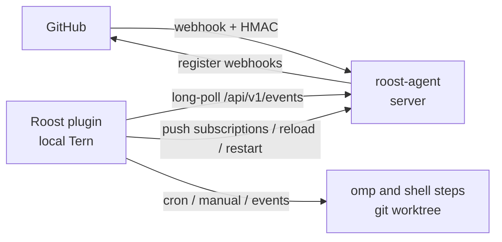

# Roost

[简体中文](README.zh-CN.md)

Roost is a Tern plugin that runs fixed omp workflows **on your machine**:

- **Active triggers**: cron schedules (scheduled locally by the plugin; no server needed) and manual runs from the console, with inputs.
- **Passive triggers**: GitHub events (issues, PRs, comments, push, workflow_run…). GitHub can't reach a laptop, so a small relay probe, `roost-agent` (Rust), runs on a server: it verifies webhooks, keeps the subscribed ones and hands them to the plugin's long-poll.

`roost-agent` runs no workflows and is not an AI runtime; it only relays events.



## Plugin

Install with `tern plugin install …` (or `tern plugin link .` while developing) and run **Roost:打开工作台** from the palette. The plugin's data directory holds:

| File | Purpose |
|---|---|
| `roost.toml` | Local binding: relay URL and token, runner settings |
| `workflows.toml` | Repos (GitHub name → local path), workflows, triggers, steps |
| `theme.css` (optional) | Your styles, applied live |

See [README.zh-CN.md](README.zh-CN.md) for the full `workflows.toml` reference (trigger filters, templates, `ROOST_*` environment, workspaces, safety defaults).

Highlights:
- Templates apply to omp prompts only; shell steps read `ROOST_*` environment variables, so event text never lands in a command line.
- Event runs use a temporary git worktree at the event's ref, removed afterwards. Cancel and timeout signal the whole process group. Running steps are adopted again after a plugin reload.
- User-content events (issues, comments, PRs) only fire for `OWNER`/`MEMBER`/`COLLABORATOR` authors unless a trigger sets `associations = ["*"]`. CI events (`workflow_run`, `check_suite`, `check_run`) whose code comes from a fork, or whose origin can't be confirmed, only fire with `forks = true`.

## Relay agent

```sh
cd agent && cargo build --release
roost-agent check --config /etc/roost/agent.toml
roost-agent serve --config /etc/roost/agent.toml
```

Start from `agent/deploy/agent.example.toml` and `agent/deploy/roost-agent.service`. Secrets accept `env:NAME` or `file:/path`.

Sync model: the plugin computes per-repo event subscriptions from `workflows.toml` and pushes them (`PUT /api/v1/subscriptions`, revision-checked). The agent stores them in `subscriptions.toml` and, with a GitHub token, creates or updates the webhooks. When the push or hook sync can't work, the console shows the exact `subscriptions.toml` to place on the server (then **Reload**) and the values to enter in GitHub's webhook settings. **Restart** re-execs the agent in place after `agent.toml` or binary changes; stored events and cursors survive.

API: `POST /hooks/github`; bearer-authenticated `GET /api/v1/events?after=&wait=` (long-poll), `GET|PUT /api/v1/subscriptions`, `POST /api/v1/reload`, `POST /api/v1/restart`, `POST /api/v1/github/sync`, `POST /api/v1/events/test`, `GET /api/v1/status`, `GET /api/v1/deliveries`; unauthenticated `GET /healthz`.

## Development

```sh
scripts/check.sh   # luau-lsp strict, Luau tests, cargo fmt/clippy/test, memory budget
```
