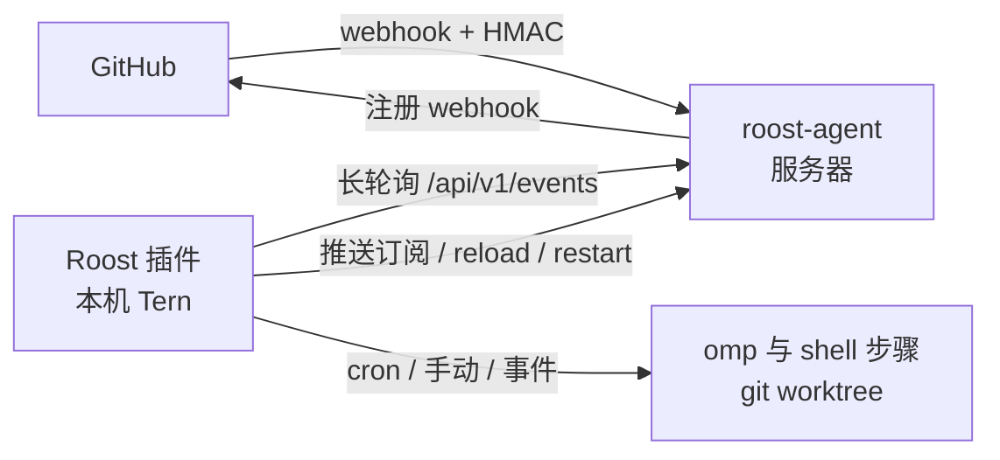

# Roost

[English](README.md)

Roost 是一个 Tern 插件形式的本地自动化工作台:在**本机**按固定流程运行 omp。触发方式有两种:

- **主动**:cron 定时(插件核心,本机调度,无需服务器);手动运行(面板按钮,可带输入参数)。
- **被动**:GitHub 事件(issues、PR、评论、push、workflow_run……)。GitHub 无法直接访问本机,所以由一个放在服务器上的小型**中继探针** `roost-agent`(Rust)接收 webhook、验签、按订阅过滤并缓存,本机插件长轮询拉取。

`roost-agent` 不运行任何工作流,也不是 AI 运行时;它只是事件中继节点。



## 安装插件

```sh
tern plugin install github.com/<owner>/<repo>    # 或开发时:tern plugin link .
```

命令面板运行 **Roost:打开工作台**。首次启动会在 `tern.plugin.data`(macOS:`~/Library/Application Support/Tern/plugin-data/roost/`)生成两个文件,保存即生效:

| 文件 | 作用 |
|---|---|
| `roost.toml` | 本机绑定:中继地址与令牌、runner 设置(omp 参数、并发、超时、PATH) |
| `workflows.toml` | 仓库(GitHub 名 → 本机路径)、工作流、触发器、步骤 |
| `theme.css`(可选) | 自定义样式,实时注入,见「外观定制」 |

### workflows.toml

```toml
[repos."acme/web"]
path = "~/code/web"     # 本机检出
branch = "main"         # cron/手动运行检出的分支
worktree = true         # 运行在临时 git worktree 中(默认);false 则直接用 path
hook = true             # 中继是否自动管理该仓库的 webhook

[[workflow]]
id = "triage"
name = "Issue 分诊"
repos = ["acme/web"]
concurrency = "queue"   # queue | skip | replace
timeout = "20m"

[[workflow.trigger]]    # GitHub 事件(经中继)
github = "issues"
actions = ["opened", "labeled"]
labels = ["roost"]

[[workflow.trigger]]    # 定时;默认本机时区,tz = "UTC" 可选
cron = "0 9 * * 1-5"

[[workflow.step]]
omp = """
分析 {{repo}} 的 issue #{{number}}:{{title}}

{{body}}
"""

[[workflow.step]]
run = "gh issue comment \"$ROOST_NUMBER\" --body-file reply.md"
```

- **触发过滤**:`actions` `labels`(`labeled` 动作只看新加的标签)`branches`(支持 `*`)`comment`(评论前缀,如 `/roost`)`senders` `associations` `workflows`、`conclusions`(workflow_run)。
- **安全默认值**:issues、评论、PR 这类「用户可写内容」事件,默认只接受 `OWNER`/`MEMBER`/`COLLABORATOR` 作者;`associations = ["*"]` 才对所有人开放。`workflow_run`/`check_suite`/`check_run` 这类 CI 事件没有作者关系,默认拒绝代码来自 fork(或无法确认来源仓库)的事件,`forks = true` 才接受。omp 以 yolo 模式运行,放开前请想清楚提示词注入与执行外部代码的风险。
- **模板**只用于 omp 提示词:`{{repo}} {{event}} {{action}} {{number}} {{title}} {{body}} {{url}} {{ref}} {{sha}} {{branch}} {{sender}} {{comment}} {{label}} {{workflow}} {{run_id}} {{trigger}} {{input.<名>}} {{payload.<路径>}}`(数组下标从 0 开始)。shell 步骤不做模板替换,改读环境变量 `ROOST_*`:`ROOST_REPO`、`ROOST_NUMBER`、`ROOST_SHA`、`ROOST_BRANCH`、`ROOST_SENDER`、`ROOST_URL`、`ROOST_EVENT_PATH`(完整 payload)、`ROOST_INFO_PATH`(归一化事件)、`ROOST_WORKSPACE`、`ROOST_INPUT_<名>` 等,事件文本不会被拼进命令行。
- **工作区**:有本机路径的仓库,事件运行在 `plugin-data/roost/worktrees/<run>` 的临时 worktree 中(检出 PR 的 `refs/pull/N/head`、push 的 sha 等),结束后自动清理;`workspace = "repo" | "temp"` 可改。
- 取消或超时会向整个进程组发送 SIGTERM,8 秒后 SIGKILL。插件重载时,仍在运行的步骤会被重新接管。

## 部署中继 roost-agent

```sh
cd agent && cargo build --release          # 产物在 /tmp/roost-cargo-target/release/roost-agent
scp /tmp/roost-cargo-target/release/roost-agent server:/usr/local/bin/
```

服务器上:

1. `agent/deploy/agent.example.toml` → `/etc/roost/agent.toml`(权限 600)。密钥写成 `env:NAME` 或 `file:/path`,并放进 `/etc/roost/env`:
   ```sh
   ROOST_TOKEN=$(openssl rand -hex 24)
   ROOST_WEBHOOK_SECRET=$(openssl rand -hex 24)
   GITHUB_TOKEN=...   # 可选:让中继自动创建 webhook(需要 admin:repo_hook 或 Webhooks 读写权限)
   ```
2. 在 TLS 反向代理(Caddy/Nginx)后暴露 `listen`,把 `server.public_url` 设为公网地址。
3. `agent/deploy/roost-agent.service` → `/etc/systemd/system/`,`systemctl enable --now roost-agent`。
4. `roost-agent check --config /etc/roost/agent.toml` 校验配置。

本机 `roost.toml`:

```toml
[relay]
url = "https://roost.example.com"
token = "<ROOST_TOKEN 的值>"   # 或 token_env = "ROOST_TOKEN"
```

### 配置同步与回退

- **本地优先**:保存 `workflows.toml` 后,插件计算每个仓库需要的事件,推送到中继(`PUT /api/v1/subscriptions`,带版本号防覆盖);中继写入 `subscriptions.toml` 并(若有 GitHub token)自动注册/更新 webhook。
- **回退到云端手动设置**:推送失败时,「中继」页给出完整的 `subscriptions.toml` 内容可复制;保存到服务器后点「重新加载」(或 `systemctl reload roost-agent`)。缺 GitHub token 或权限时,同一页列出每个仓库手动添加 webhook 需要的 Payload URL、Content type、事件与密钥说明。
- 服务器上手改过订阅后,本机再推送会提示冲突:可「以本地覆盖」或「采用云端」。
- **远程重启**:`agent.toml` 改动(或换了二进制)后,点「重启中继」即可,无需登录服务器。中继原地 `exec` 自身(PID 不变),已缓存的事件与游标保留。

### 中继 API

除 `/healthz` 与 `/hooks/github` 外都需要 `Authorization: Bearer <token>`。

| 方法 | 路径 | 说明 |
|---|---|---|
| POST | `/hooks/github` | GitHub webhook(验证 `X-Hub-Signature-256`) |
| GET | `/api/v1/events?after=&wait=&limit=` | 拉取事件,`wait` 秒长轮询(≤30) |
| GET/PUT | `/api/v1/subscriptions` | 读取/推送订阅(`base_revision` 不符返回 409) |
| POST | `/api/v1/reload` | 重新读取 `subscriptions.toml`(SIGHUP 同效) |
| POST | `/api/v1/restart` | 原地重启 |
| POST | `/api/v1/github/sync` | 同步 webhook(`{"dry_run": true}` 只预览) |
| POST | `/api/v1/events/test` | 产生一条 `roost_test` 事件,验证全链路 |
| GET | `/api/v1/status`、`/api/v1/deliveries` | 状态、最近投递记录 |

## 外观定制

面板全部由 Tern 原生元素绘制(表格、分栏、ANSI 日志、状态徽章),视图按节点 key 增量更新,日志只发送追加部分。`roost.css` 顶部列出了所有 `data-role` 钩子;在 `plugin-data/roost/theme.css` 中写样式即可覆盖,保存后实时生效,插件目录不会被改动。

## 开发

```sh
tern plugin link .
scripts/check.sh            # luau-lsp 严格检查、Luau 测试、cargo fmt/clippy/test、记忆预算
python3 tests/run.py        # 只跑 Luau 测试
```
