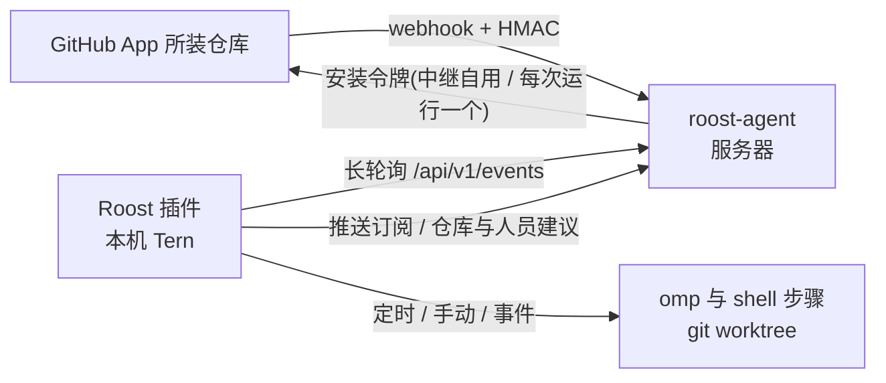

# Roost

[English](README.md)

Roost 是一个 Tern 插件形式的本地自动化工作台:在**本机**按固定流程运行 omp。新建和编辑自动化的方式对标 grok.com/automations:在面板里点「新建自动化」或从模板开始,用表单选触发器、写指令,保存即生效。触发方式有两种:

- **主动**:定时,包括一次、每小时、每天、每周、每月、每年和自定义 cron,由插件在本机调度,无需服务器;也可以在面板上手动运行,可带输入参数。
- **被动**:GitHub 事件,如 PR 打开/推送/合并、评论、审查、标签、分支推送、CI 完成等。GitHub 无法直接访问本机,所以服务器上放一个小型**中继** `roost-agent`(Rust)。它以 **GitHub App** 的身份接收所装仓库的 webhook,验签、按订阅过滤并缓存,本机插件长轮询拉取。

`roost-agent` 不运行任何工作流,也不是 AI 运行时;它只是事件中继节点。



## 安装插件

```sh
tern plugin install github.com/<owner>/<repo>    # 或开发时:tern plugin link .
```

命令面板运行 **Roost:打开工作台**。首次启动会在 `tern.plugin.data`(macOS:`~/Library/Application Support/Tern/plugin-data/roost/`)生成两个配置文件,保存即生效;运行产生的数据也放在这里:

| 文件 | 作用 |
|---|---|
| `roost.toml` | 本机绑定:中继地址与令牌、runner 设置(omp 参数、agent 会话名、并发、超时、PATH)、`[retention]` 保留策略、`[github] login`(可选,你的 GitHub 用户名) |
| `workflows.toml` | 仓库(GitHub 名 → 本机路径)、自动化、触发器、步骤;面板的表单编辑器读写的就是它 |
| `runs.json`、`runs/<run>/`、`worktrees/<run>/` | 运行历史;每个运行的日志、事件负载与 omp 会话;事件运行的临时 worktree |
| `events.json` | 「事件」页:收到的每个中继事件,以及它启动的运行或没有触发的原因 |
| `groups.json` | 「工作流」页的分组:名称、顺序、是否收起,以及每个工作流在哪个分组(只影响展示)。导出时按名字带上分组:单独导出只带该工作流所在的分组;导出全部按页面上的分组顺序排列工作流,并带上全部分组(包括空分组)。导入时同名分组合并、没有就新建;本机已经在某个分组里的工作流保持原分组 |
| `theme.css`(可选) | 自定义样式,实时注入,见「外观定制」 |

### 在面板中新建自动化

「工作流」页每个工作流一张卡片,可以按分组归类(见下方「面板」一节);卡片右上角的「编辑」打开表单。「新建自动化」会打开一个表单,也可以从旁边的「从模板」菜单开始(还没有工作流时,页面直接显示模板库)。表单内容:

- **名称与图标**。
- **触发器**:点「＋添加触发器」,菜单按「定时」和「GitHub」分组。
  - 定时触发器显示成一句话,例如「每周 ▾ 在 一 三 五 于 09:00」「每小时 ▾ 在 工作日 9:00–18:00 之间」。
  - GitHub 触发器显示成一张卡片,列出该种类支持的筛选器,空着表示「任意」。仓库、作者、负责人、标签、分支、工作流名称这几项会通过 GitHub App 给出建议。
  - 每个 GitHub 触发器至少要设一个筛选器。
- **指令**:即 omp 提示词,可以选模型;另外可以追加更多 omp 或 shell 步骤。模型下拉框来自本机 omp(`omp config get modelRoles` 与 `omp models --json`,PATH 含 `[runner] extra_path`,缓存 5 分钟):**Auto**(不传 `--model`,即 omp 的 `default` 角色)、角色 `@<角色>`(由 omp 按 `modelRoles` 解析,改了 omp 的角色配置就跟着变)、各 provider 的聊天模型 `provider/id`;`workflows.toml` 里手写的值(例如带 `:high` 思考后缀)照样保留可选。
- **通知**:运行结束时在 Tern 弹出通知。
- **高级**:id、并发、工作区、超时、时区、外部贡献者与 fork 的放行。

保存时整份文件用同一套校验规则检查。只有这一条自动化对应的 `[[workflow]]` 块会被替换,文件里的其他内容和注释保持不变,旧文件备份为 `workflows.toml.bak`。

### workflows.toml

```toml
[repos."acme/web"]
path = "~/code/web"     # 可选:本机检出;没声明的仓库在临时目录中运行
branch = "main"         # 定时/手动运行检出的分支
worktree = true         # 运行在临时 git worktree 中(默认);false 则直接用 path

[[workflow]]
id = "pr-review"
name = "PR 审查"
icon = "eye"
notify = true           # 运行结束时弹出通知(默认)
concurrency = "queue"   # queue | skip | replace
timeout = "20m"

[[workflow.trigger]]    # GitHub(经中继)
github = "pr_opened"
repos = ["acme/web"]    # 支持 owner/*
authors = ["@me"]       # @me = 你自己

[[workflow.trigger]]    # 定时;默认本机时区,tz = "UTC" 可选
schedule = "weekly"
days = ["mon", "wed", "fri"]
time = "09:00"

[[workflow.step]]
omp = """
审查 {{repo}} 的 PR #{{number}}:{{title}}

{{url}}
"""
```

**定时**(`schedule`):

| 值 | 参数 |
|---|---|
| `once` | `at = "2026-11-06 08:30"`;错过时一小时内补跑一次 |
| `hourly` | `days`(可空 = 每天)、`between = ["09:00", "18:00"]`(整点,省略 = 全天),每个整点触发 |
| `daily` | `time` |
| `weekly` | `days`(`sun`…`sat`,至少一天)、`time` |
| `monthly` | `day`(1–31,没有这天的月份跳过)、`time` |
| `yearly` | `date = "MM-DD"`、`time` |
| `cron` | `cron = "0 9 * * 1-5"` |

所有定时都可以加 `tz`、`repo`(在哪个本机检出中运行)、`ref`。

**GitHub**(`github`,各种类只接受下表列出的筛选器):

| 值 | 何时触发 | 筛选器 |
|---|---|---|
| `pr_opened` | PR 打开(非草稿)或标记为可审查 | repos authors |
| `pr_draft` | PR 以草稿打开或转为草稿 | repos authors |
| `pr_pushed` | 新提交推送到 PR | repos authors skip_drafts |
| `pr_merged` | PR 合并 | repos authors include_closed |
| `comment` | PR 或议题上有新评论 | repos authors assignees comment ignore_bots ignore_self |
| `push` | 提交推送到分支 | repos authors branches |
| `label` | PR 或议题的标签被添加或移除 | repos authors assignees label_actions labels |
| `check_completed` | 检查套件完成 | repos authors conclusions forks |
| `issue_comment` | 纯议题(非 PR)上有新评论 | repos authors assignees comment ignore_bots ignore_self |
| `review_comment` | PR 上有新的审查评论 | repos authors assignees comment ignore_bots ignore_self |
| `review` | PR 审查提交 | repos authors assignees review_states ignore_bots ignore_self |
| `review_thread` | 审查线程被解决或重新打开 | repos authors thread_actions |
| `workflow_run` | Actions 工作流运行完成 | repos authors branches conclusions workflows forks |
| `issue_opened` | 新议题创建 | repos authors labels ignore_bots |
| `event` | 任意事件(`event = "release"`) | repos authors actions branches labels comment |

- 列表筛选器之间是「且」,同一个列表里的多个值是「或」,空着表示任意。
- 「作者」的含义:评论、审查事件里是写评论或审查的人,PR、议题事件里是 PR 或议题的作者,push 事件里是推送者。
- 开关项及默认值:`skip_drafts` 默认开,`include_closed` 默认关,`ignore_bots` 默认开,`ignore_self` 默认开。`ignore_self` 忽略你自己的活动,前提是 `roost.toml` 设了 `[github] login`,或者 App 归你个人所有;把自己(`@me`)写进 `authors` 就会放行你自己的活动。
- **安全默认值**:议题、评论、PR 这类「用户可写内容」事件,默认只接受 `OWNER`/`MEMBER`/`COLLABORATOR` 作者;设 `associations = ["*"]`(表单「高级」里的「允许外部贡献者」)才对所有人开放。`check_completed`/`workflow_run` 默认拒绝代码来自 fork(或无法确认来源)的事件,设 `forks = true` 才接受。omp 以 yolo 模式运行,放开前请想清楚提示词注入与执行外部代码的风险。
- **模板**只用于 omp 提示词:`{{repo}} {{event}} {{action}} {{number}} {{title}} {{body}} {{url}} {{ref}} {{sha}} {{branch}} {{sender}} {{comment}} {{label}} {{workflow}} {{run_id}} {{trigger}} {{input.<名>}} {{payload.<路径>}}`(数组下标从 0 开始)。shell 步骤不做模板替换,改读环境变量 `ROOST_*`:`ROOST_REPO`、`ROOST_NUMBER`、`ROOST_SHA`、`ROOST_BRANCH`、`ROOST_SENDER`、`ROOST_URL`、`ROOST_EVENT_PATH`(完整 payload)、`ROOST_INFO_PATH`(归一化事件)、`ROOST_WORKSPACE`、`ROOST_INPUT_<名>` 等,事件文本不会被拼进命令行。
- **环境变量继承**:shell 步骤以及插件调用的本机工具(`gh`、`omp`)继承你登录 shell 的环境变量,不只是 Tern daemon 的精简环境。插件启动时和之后每 10 分钟,用账户的登录 shell(macOS 取目录服务记录,否则 `$SHELL`,fish 也支持)以 `-l -i -c` 运行一次,读取两个标记之间的 `env -0` 输出,启动文件打印的内容会被忽略;去掉 PWD/OLDPWD/SHLVL/_。结果只保存在内存里。优先级:登录环境 < `[runner] env` < 工作流 `env` < `ROOST_*`;PATH 为 `[runner] extra_path` 加上登录 shell 的 PATH(`env` 里显式设了 PATH 时以它为准)。第一次读取结束前(最多 10 秒),运行不会启动,也不会推进;读取失败会弹出通知,并沿用上一次读到的环境(一次都没读到时用 daemon 的环境)。以 App 身份运行的 shell 步骤不带登录 shell 里的 `GH_TOKEN`/`GITHUB_TOKEN`/`GH_ENTERPRISE_TOKEN`/`GITHUB_ENTERPRISE_TOKEN`(你在 `env` 里显式设的保留);omp 步骤在 Tern 的 agent block 里运行,用的是 Tern 的登录环境,以 App 身份运行时会先 unset 后三个,再换上本次运行的 `GH_TOKEN`。
- **步骤输出与条件**:shell 步骤可以向 `$ROOST_OUTPUT` 追加 `键=值` 行(键为字母、数字、下划线,值一行),之后的步骤在提示词里用 `{{out.<键>}}`、在 shell 里用 `ROOST_OUT_<键大写>` 读取。步骤加 `when = "out.<键>"` 或 `when = "input.<名>"`(前面加 `!` 取反)时,只有该值为真(非空,且不是 `0`/`false`/`no`)才运行,否则记为「已跳过」并继续下一步。输出 `stop=<原因>` 会在该步骤成功后结束整个运行,运行记为「已跳过」(不弹通知),适合「没有要处理的东西」。`$ROOST_OUTPUT` 只接受普通文件,只在 shell 步骤里提供。
- **费用与预算**:omp 步骤结束后,插件汇总它会话目录里所有 JSONL(包括子代理)中的 `usage.cost.total` 与 `totalTokens`,记到步骤上,运行详情、步骤表与工作流卡片显示估算费用(按 omp 的标价估算,订阅类 provider 记为 0)。工作流设 `daily_budget = 5`(美元)后,当天(本机时区)该工作流 omp 步骤的累计费用达到预算时,后续 omp 步骤不再启动,运行记为「已跳过」并写明原因。
- **工作区**:在 `[repos]` 里声明了本机路径的仓库,事件运行在 `plugin-data/roost/worktrees/<run>` 的临时 worktree 中(检出 PR 的 `refs/pull/N/head`、push 的 sha 等),结束后自动清理;`workspace = "repo" | "temp"` 可改。没声明的仓库在临时空目录中运行。手动运行用触发器唯一指向的已声明仓库(定时的 `repo`、GitHub 触发器不含通配的 `repos`),否则用唯一声明的仓库;`workspace = "worktree" | "repo"` 却确定不了仓库时拒绝手动运行。
- **手动指定 PR**:有 PR 类触发器(PR 打开/草稿/推送/合并、审查、审查评论、审查线程)的工作流,点「运行」时表单多一个「拉取请求」字段,填 `owner/name#12`、PR 链接,或在触发器只指向一个仓库时只写编号;只有 PR 类触发器时必填,还有其他触发器时留空就是普通手动运行。插件用本机 `gh api repos/<仓库>/pulls/<编号>` 读取 PR(PATH 含 `[runner] extra_path`;中继不提供 PR 读取),把它整理成和 webhook 相同的事件字段(`action = "manual"`),`payload` 为 `{action, pull_request, repository}`,在 PR head(`refs/pull/N/head`)上运行;读取期间取消表单则不排队。
- 取消或超时时,shell 步骤会向整个进程组发送 SIGTERM,8 秒后 SIGKILL;omp 步骤直接关闭它的 agent 标签页。插件重载时,仍在运行的步骤会被重新接管。

### omp 步骤与会话

- omp 步骤以 **Tern 原生 agent block** 运行。Tern 窗口在固定会话(`roost.toml` 的 `[runner] session`,默认 `Roost`,不存在时自动创建)里新开一个标签页执行。打开时不会抢走焦点。这一轮结束后标签页自动关闭,成功或失败都会关;如果被人手动关掉,这一步按失败处理。
- agent 运行期间,插件每 2 秒读取它的会话文件,把进展写进运行日志:标签页打开、每段说明文字、每次工具调用(一行,取工具的意图说明或路径/命令)、失败的工具结果,最后是完整的最终回复和结束状态。会话文件里没有最终回复时(例如没能打开 agent),改为追加窗口记录的最后一条消息。
- agent 只能由窗口打开:插件 host 把任务写进运行目录和 kv,所有窗口用 `mkdir` 认领,保证只有一个窗口去打开。**没有打开的 Tern 窗口时,omp 步骤会一直等待,直到有窗口出现或超时**。agent 已经打开后如果所有窗口都关了,取消和超时要等有窗口重新打开后才会关掉它。
- omp 以交互式运行,会话保存在运行目录 `runs/<run>/s<步骤>.session/`(`--session-dir`),不会写入 `~/.omp`。这些会话随运行一起按 `[retention]` 清理。`-p`、`--session-dir`、`--resume`、`--continue` 等参数由 Roost 管理,写进 `omp_args` 或步骤 `args` 会报配置错误。
- omp 步骤收不到 `[runner] env`、工作流 `env` 以及 `ROOST_*` 环境变量,环境沿用 Tern 打开 agent 时的环境。需要的信息请通过提示词模板传入。
- **打开会话**:在运行详情的步骤时间线里双击 omp 步骤(或右键「Open session」),或点详情里的「omp 会话」按钮(打开最后一个 omp 步骤)。还在运行的会话会跳到它的标签页;已结束的会话会在新标签页中用 `omp --resume` 继续打开。

### 脚本文件、文件库与导出

脚本和提示词不必写成「脚本位置 + 执行命令」,由 Roost 保管在插件数据目录,在编辑器的「文件」区直接编写:

| 位置 | 说明 |
|---|---|
| `workflows/<id>/files/` | 工作流自己的文件,随工作流保存;改 id 时一起搬走,删工作流时一起删除 |
| `library/<库>/` | 文件库:多个工作流共用的脚本和提示词。工作流用 `libs = ["库"]` 声明,或在步骤里写 `file = "@库/路径"`;仍被使用的库删不掉。在「文件」页管理 |
| `state/<组>/` | 跨运行保留的状态(`state = "组名"`,默认是工作流 id)。**不会自动删除**,在「文件」页手动删 |

```toml
[[workflow]]
id = "triage"
state = "triage"              # $ROOST_STATE 指向 state/triage/
libs = ["fluxdown"]

[[workflow.step]]
file = "@fluxdown/issues.py"  # 文件库里的脚本;"scan.py" 则是工作流自己的文件
args = ["triage-scan"]        # 作为命令行参数传给脚本
```

- 文件步骤按扩展名选解释器:`.py` → `python3`,`.sh` → `/bin/sh`,`.bash` → `bash`,`.js`/`.mjs`/`.cjs` → `node`(在步骤的 PATH 中查找)。其余类型不能作为步骤,但可以放在文件里被脚本读取(如提示词 `.md`)。路径各段只能以字母、数字或 `_` 开头(没有隐藏文件和 `..`),最多 8 层;单个文件 ≤512 KiB,每个目录树 ≤200 个文件、总计 ≤4 MiB。
- **运行用的是副本**:运行开始时,Roost 把工作流文件复制到 `runs/<run>/files/`,用到的库复制到 `runs/<run>/lib/<库>/`。运行期间再编辑文件不影响正在跑的运行;缺库则运行直接失败。副本随运行目录按 `[retention]` 清理。
- **环境变量**:`ROOST_FILES`(工作流文件副本)、`ROOST_LIB`(库副本的上级目录)、`ROOST_STATE`(状态目录)、`ROOST_TMP`(临时目录)。`PYTHONPYCACHEPREFIX` 指向 `$ROOST_TMP/pycache`,Python 的缓存不会落进文件里。`$ROOST_TMP` 在运行结束时删除;命令里的 `run` 步骤同样拿到这些变量。
- **导出**:工作流卡片的「导出」或工具栏的「导出全部」,生成 `plugin-data/roost/exports/<时间>-<名>.roost.toml`(路径自动复制)。文件自包含:工作流定义、它的私有文件、它用到的整个文件库、仓库的 `branch`/`worktree`(**不含本机路径**)。不含状态、运行历史和凭据。只保留最新 50 个导出文件,「存储与清理」可清空。
- **导入**:「导入」填路径或 exports 里的文件名,先预览再导入。导入的工作流一律**停用**,需检查后手动启用;已存在的工作流、内容不同的库只在「覆盖导入」时替换。仓库的本机检出路径需要自己在 `workflows.toml` 里填。校验全部通过才开始写,先写文件、最后写 `workflows.toml`(带 `.bak`)。
- 老的 FluxDown 流水线可以用 `scripts/migrate-fluxdown.py` 一次性迁入文件库 `fluxdown`(有排队或运行中的 FluxDown 运行时拒绝执行)。

### 标签页、自迭代与自升级

**标签页步骤**:工作流可以开关 Tern 标签页,但只能关 Roost 自己开的。

```toml
[[workflow.step]]
name = "打开日志"
tab = "open"                       # open | close
key = "logs"                       # 标签页的键,按工作流区分(别的工作流关不到它)
command = "tail -f \"$ROOST_RUN_DIR/log.txt\""   # 可选;留空则打开 shell
title = "运行日志"                 # 可选,默认步骤名
keep = false                       # 默认 false:运行结束时自动关闭;true 则保留到 tab = "close"
focus = false                      # 默认在 Roost 会话后台打开;true 则在当前会话打开并切过去

[[workflow.step]]
tab = "close"
key = "logs"
```

- 由 Tern 窗口执行:host 把操作写进 `tabs/ops/`,窗口用 `mkdir` 认领(多个窗口只有一个执行),120 秒内没有本机窗口处理则该步失败。
- 每个打开的标签页登记在 `tabs/open/<工作流>.<键>.json`(pane id 与块类型);关闭前核对 pane 仍在、类型没变,对不上就只删登记不关。手动关掉的标签页会从登记里移除。同一个键再次 open 会先关掉旧的。
- `command` 不做模板替换,经一个只含 `ROOST_*`(运行 id、目录、工作区、文件、状态、输入与输出)的环境文件启动,不含令牌。

**工作流自迭代**:设置了 `evolve` 的工作流是「迭代者」,可以改其他工作流的脚本、提示词和 `[[workflow]]` 块。

```toml
[[workflow]]
id = "doctor"
evolve = ["*"]                     # 或具体 id;不能包括自己,被迭代的工作流不能再有 evolve
concurrency = "skip"

[[workflow.trigger]]
roost = "run_failed"               # 被迭代的工作流失败或超时时触发(中断、取消不算)
streak = 1                         # 连续这么多次才触发
# workflows = ["triage"]           # 可选:只对这些工作流

[[workflow.trigger]]               # 也可以定时巡检
schedule = "daily"
time = "04:00"

[[workflow.step]]
omp = "迭代材料在 {{evolve_dir}},先读 README.md……触发的工作流 {{evolve_target}},运行 {{evolve_run}}"
```

- 迭代者的每次运行先有一步「准备迭代材料」,写进 `runs/<id>/evolve/`:`digest.md`/`digest.json`(最近 10 次运行、近 7 天健康度、以往修订)、`logs/`(失败日志末尾各 48 KiB)、`base/` 与可编辑的 `edit/`(`workflows/<id>/workflow.toml` + `files/`,以及只被这些工作流使用的文件库)。
- 运行**成功**结束后,Roost 比较 `edit/` 与 `base/`,和编辑器保存走同一套校验后自动应用;期间被别处改过的工作流跳过,改 id、加 `evolve` 的改动丢弃。每次应用记为一个修订,修订前后的快照在 `revisions/<n>/`。
- **自动回滚**:之后被改动工作流(和用到被改文件库的工作流)的运行会被观察:至少 2 次失败且失败率比修订前高 25% 以上就恢复修订前的快照(修订后又被别处改过的不自动恢复);观察 5 次运行或 7 天后保留。总览页「自迭代」卡片列出修订,可手动回滚。
- 防止空转:同一迭代者对同一工作流 30 分钟内只触发一次,每天最多 20 次;迭代者自己的失败不触发;刚被自动回滚的那次失败也不触发。费用用工作流的 `daily_budget` 限制。
- 模板库「自迭代」组里有现成的「工作流自迭代」。

**Roost 自升级**:`upgrade = true` 步骤把本次运行 worktree 里的新提交应用到 Roost 自己的插件目录,这是插件唯一会写插件目录的地方,而且只在插件进程外进行。

1. 先克隆插件目录作为源码仓库,并在 `workflows.toml` 声明:`git clone <插件目录> ~/Library/Application\ Support/Tern/plugin-data/roost/repos/roost`,`[repos."local/roost"] path = "<上面的目录>"`、`branch = "main"`。
2. 工作流在这个仓库的 worktree 里运行(`workspace = "worktree"`,`identity = "local"`):omp 步骤改代码、跑 `scripts/check.sh`、`git commit`,最后一步 `upgrade = true`。模板「Roost 自升级」就是这样。
3. `upgrade` 步骤检查:`tern` 在 PATH 上,提交必须是插件目录当前 HEAD 的后续、插件目录没有未提交的修改且在分支上,然后在一个干净的 worktree 里用**插件当前版本**的 `scripts/check.sh` 检查这个提交(提交改不了评判自己的检查)。通过后交给后台脚本(`upgrade/<运行>.apply.sh`,结束时自删)。
4. 后台脚本 fast-forward 插件目录,执行 `tern plugin reload roost`,等新版本 host 加载完写出 `boot.txt`;重载失败或 90 秒内没有新的 boot,就 `git reset --keep` 回到旧提交并再重载。结果写进 `upgrades/<运行>.json`,下次启动时以通知报告,总览页「自迭代」卡片也列出最近的升级。

### 数据保留与清理

长期积累的数据都有自动清理和手动清理两种方式:

| 数据 | 自动清理 | 手动清理 |
|---|---|---|
| 运行记录、日志、事件负载、omp 会话、遗留 worktree | `[retention] runs = 200`、`run_age = "30d"`:超出数量或结束超过时长的**已结束**运行会被删除;没有对应运行的目录一并清掉 | 运行详情的「删除」;「配置 → 存储与清理」的「按策略清理」「删除全部已结束运行」 |
| 「事件」页记录(`events.json`) | `events = 200`、`event_age = "30d"` | 「事件」页或「存储与清理」的「清空记录」 |
| 中继的事件缓存(服务器 `events/`) | `agent.toml` 的 `[store] keep_events`、`max_age`、`max_total_bytes` | 「中继」页的「清空中继事件缓存」 |
| 中继的投递统计(服务器内存) | 最近 200 条、统计 256 组,重启即清空 | 「中继」页的「清空统计」 |

- 自动清理在插件启动时、每小时一次、`[retention]` 首次生效或修改之后执行。roost.toml 有错误时不按策略删除任何东西;旧的 `[runner] keep_runs` 会报错并提示改成 `[retention] runs`。时长写 `"0"` 表示不按时间清理,否则至少 `1h`。`runs` 只计已结束的运行,排队中和运行中的运行不会被删除。
- 目录在后台分批删除:每批最多 8 个,交给 `rm -rf` 在插件进程外执行,所以不会卡住面板,也不会跟随 worktree 里的符号链接删到外面。删除失败的目录会重试。「存储与清理」卡片显示各部分的磁盘占用、上次自动清理删了什么,以及还有多少目录在等待删除。如果 `runs.json` 曾无法读取(留有 `runs.json.unreadable`),就暂不清理无主目录,以免误删旧运行。
- 删除和清空都要点两次,两次点击之间要隔 0.8 到 5 秒,所以双击不会误删。第一次点击后按钮变成「确认…」,按键、切换选择或做别的操作都会取消。
- 「事件」页每行的「结果」列显示它启动的运行和运行状态,选中这一行会跳到对应的运行;运行已被清理的标为「记录已清理」。首次连接中继,或者还没有 `events.json` 时,会取回中继里最近 20 条已读事件作为历史,只展示不触发;如果当时启动过运行,会按投递 id 关联上。
- 「中继」页底部的「Webhook 投递」按结果、事件和仓库统计 GitHub 发来的 webhook。「已忽略」表示没有任何工作流订阅这个事件,所以不会转发到本机,本机的「事件」页也看不到它。给工作流加上对应的 GitHub 触发器后,订阅会自动同步。

## 部署中继 roost-agent

```sh
cd agent && cargo build --release          # 产物在 /tmp/roost-cargo-target/release/roost-agent
scp /tmp/roost-cargo-target/release/roost-agent server:/usr/local/bin/
```

服务器上:

1. `agent/deploy/agent.example.toml` → `/etc/roost/agent.toml`(权限 600)。管理令牌写成 `env:NAME` 或 `file:/path`,并放进 `/etc/roost/env`:`ROOST_TOKEN=$(openssl rand -hex 24)`。
2. 在 TLS 反向代理(Caddy/Nginx)后暴露 `listen`,把 `server.public_url` 设为公网地址(GitHub 要用它回调和投递 webhook)。
3. `agent/deploy/roost-agent.service` → `/etc/systemd/system/`,`systemctl enable --now roost-agent`。
4. `roost-agent check --config /etc/roost/agent.toml` 校验配置。

本机 `roost.toml`:

```toml
[relay]
url = "https://roost.example.com"
token = "<ROOST_TOKEN 的值>"   # 或 token_env = "ROOST_TOKEN"
```

### 创建 GitHub App

中继以 GitHub App 的身份工作,不需要个人令牌,也不用逐个仓库配置 webhook:

1. Roost「中继」页点「创建 GitHub App」。要建在组织下,先填组织名。
2. 浏览器打开中继的页面,页面会自动把 App 清单提交给 GitHub。GitHub 显示确认页,名称可以改,确认后点创建。
3. GitHub 回调中继。中继把 App 的 id、私钥和 webhook 密钥保存到 `<data>/github-app.json`(权限 600),然后跳转到安装页。在安装页选择要安装的仓库。
4. 以后要增减仓库,在 GitHub 的 App 安装设置里修改。

App 申请的仓库权限:actions、checks、contents、deployments、discussions、issues、pull_requests、statuses、workflows 为读写,metadata 只读,另有 administration 读写。中继用 App 接收事件、给表单提供仓库/人员/标签/分支/工作流名称的建议,并给每次运行签发令牌(见下一节)。「忘记本地凭据」只删除中继上的凭据,App 本身要到 GitHub 设置里删除。

2026-11-06 之前创建的 App 只有只读权限。GitHub 不允许通过 API 修改 App 权限,需要手动升级:「中继」页点「权限设置」,在 Permissions 中按上面的列表开启读写,保存;再到每个安装(组织或个人账号的 Installed GitHub Apps)接受新权限。「中继」页会列出还没生效的权限。

头像:GitHub 没有设置 App 头像的 API,只能在 App 设置页上传。「中继」页点「设置头像」打开设置页,Roost 自带的头像在 `assets/app-logo.png`(512×512,源文件 `assets/app-logo.svg`)。

### 以 App 身份运行

运行在 GitHub 上的操作(评论、审查、推送、开 PR)默认以 App 的机器人账号 `<slug>[bot]` 进行。`roost.toml` 的 `[github] identity = "local"` 可改回本机 `gh` 身份,单个工作流可用 `identity = "app" | "local"` 覆盖。没有关联仓库的运行总是用本机身份,日志里会写明。

- 以 App 身份的运行,第一步是「获取 App 令牌」:插件调用 `POST /api/v1/github/token`,中继签发一个**只限该仓库**的安装令牌,包含安装授予的所有权限,唯独去掉 administration。令牌约一小时过期,运行期间插件会在到期前 15 分钟自动续期;运行结束后删除令牌文件。
- **禁止强推默认分支**:签发令牌前,中继检查仓库默认分支(通常是 main)是否已有禁止强推和删除的规则;没有就用 administration 权限加上规则集「Roost: protect default branch」(non_fast_forward + deletion,仓库管理员可绕过,App 不能)。规则加不上(例如私有仓库所在账号的套餐不支持规则集,或安装还没接受 administration 权限)时,中继拒绝签发令牌,运行失败并在日志中写明原因。其他分支的强推、rebase、合并、推送到 main(快进)都允许。
- 令牌保存在运行目录的 `app-token`(权限 600),只经标准输入写入,不出现在命令行或环境文件里。shell 步骤得到 `GH_TOKEN`;所有步骤都会把 `<plugin-data>/bin/gh` 放到 `PATH` 最前,这个包装每次调用都读取当前令牌再执行真正的 `gh`。git 通过 `GIT_CONFIG_*` 只对 github.com 使用该令牌(清掉你自己的凭据助手),ssh 远端改走 https,提交作者与提交者是 App 机器人(`<id>+<slug>[bot]@users.noreply.github.com`)。
- omp 步骤:`cx.agents:start` 不能传环境变量,所以 omp 通过 `/bin/sh` 先 source 运行目录里的 `s<i>.env`(只含上述变量,不含令牌)再启动。准备与清理 worktree 仍用你本机的 git 身份。之后从运行详情续开的历史会话也是本机身份。
- 工作流触发器的「忽略我自己的活动」同样忽略 App 机器人的活动,避免 Roost 回复自己的评论形成循环。
- 限制与注意:中继地址必须是 https(本机回环地址除外),否则不签发 App 令牌;令牌或身份丢失(例如插件恰好在令牌步骤后重载)时,后续步骤直接失败,不会退回你的身份。`$GH_TOKEN` 是步骤启动时的快照,超过一小时的步骤里直接读它的工具(curl 等)应改读 `$ROOST_GH_TOKEN_FILE`;`gh` 包装和 git 凭据总是读最新令牌。你的 git 配置里若有 `url.….pushInsteadOf` 把 github.com 推送改回 ssh,推送仍会用你的 ssh 密钥。

### 配置同步与回退

- **本地优先**:保存 `workflows.toml` 后,插件计算每个仓库需要的事件,推送到中继(`PUT /api/v1/subscriptions`,带版本号防覆盖)。仓库筛选为空的触发器订阅在 `"*"`(任意仓库)下。中继只保留订阅了的事件。
- **回退到云端手动设置**:推送失败时,「中继」页给出完整的 `subscriptions.toml` 内容可复制;保存到服务器后点「重新加载」(或 `systemctl reload roost-agent`)。
- 服务器上手改过订阅后,本机再推送会提示冲突:可「以本地覆盖」或「采用云端」。
- 订阅状态以中继 `/status` 报告的版本为准:中继运行的正是本机上次推送的版本且本地没改 →「已同步」;采用云端后 →「沿用云端」(本地修改工作流后自动改推本地版本);还没拿到中继状态 →「待核对」。「推送订阅」总会发起一次推送,即使内容没变。
- **远程重启**:`agent.toml` 改动(或换了二进制)后,点「重启中继」即可,无需登录服务器。中继原地 `exec` 自身(PID 不变),已缓存的事件与游标保留。

### 中继 API

除 `/healthz`、`/hooks/github` 和 `/github/app/*` 页面外,都需要 `Authorization: Bearer <token>`。

| 方法 | 路径 | 说明 |
|---|---|---|
| POST | `/hooks/github` | GitHub App webhook(用 App 的密钥验证 `X-Hub-Signature-256`) |
| GET | `/api/v1/events?after=&wait=&limit=` | 拉取事件,`wait` 秒长轮询(≤30) |
| GET/PUT | `/api/v1/subscriptions` | 读取/推送订阅(`base_revision` 不符返回 409) |
| POST | `/api/v1/reload` | 重新读取 `subscriptions.toml`(SIGHUP 同效) |
| POST | `/api/v1/restart` | 原地重启 |
| POST | `/api/v1/github/app/manifest` | 开始创建 App(`{"org"?, "name"?}`),返回要在浏览器打开的地址 |
| DELETE | `/api/v1/github/app` | 删除本地 App 凭据 |
| GET | `/api/v1/github/{repos,people,labels,branches,workflows}?repo=` | 表单建议 |
| POST | `/api/v1/github/token` | 为一次运行签发 App 令牌(`{"repo"}`):先确保默认分支禁止强推与删除,返回 `token`、`expires_in`、`login`、`email`、`permissions`、`branch`、`protection` |
| POST | `/api/v1/events/test` | 产生一条 `roost_test` 事件,验证全链路 |
| DELETE | `/api/v1/events` | 清空缓存的事件(序号继续递增,客户端游标仍然有效;还没读到的客户端会看到缺口提示) |
| GET | `/api/v1/status`、`/api/v1/deliveries` | 状态(含 App 信息);最近投递,以及按结果、事件、仓库的计数(内存中,从启动或上次清空开始) |
| DELETE | `/api/v1/deliveries` | 清空投递记录与计数 |
| GET | `/github/app/new`、`/github/app/callback`、`/github/app/installed` | App 注册流程的浏览器页面 |

## 外观定制

面板按 Tern 设计规范组织成一页:标题行(版本、工作流数、中继地址、状态徽章)、页签,再是当前视图。

- **概览**:4 个指标(运行中、24 小时运行数、24 小时成功率、下一次定时),近 14 天的「运行次数」(成功 / 失败)与「运行耗时」(P50 / P95)折线图,以及每个工作流的健康表(运行数、成功率、P50/P95、每日趋势、最近运行、下次定时);下面是即将触发的定时和通知。
- **运行**:左右分栏铺满整个面板,页面本身不滚动。左边是运行列表(状态、运行 ID、工作流与事件摘要、触发方式、估算费用(只有 omp 步骤有统计的运行才有)、时间、耗时;变窄时依次隐藏触发方式、ID 列、费用,悬停行可看完整 ID,右键菜单可复制),右边是选中运行的详情:标题行(工作流名、事件摘要、状态、耗时、重跑/取消),键值对齐的事实表(第一行是运行 ID,与磁盘上的 `runs/<ID>/` 同名,排查和沟通时直接引用;其后是失败原因、触发与事件链接、仓库与 ref、身份、输入、创建时间、估算费用),步骤时间线(每个步骤按开始时间和耗时画成条;双击 omp 步骤打开它的会话),omp 会话 / 日志文件 / 复制 ID / 自动换行 / 工作区按钮,最后是实时日志,占满详情的剩余高度并在其中滚动。「自动换行」默认打开,日志按窗格宽度换行;关闭后长行保持一行,只在日志区内横向滚动。
- **工作流**:每个工作流一张卡片平铺(宽窗口每行 2–3 张):标题右侧是「分组」「编辑」「导出」「运行」,正文是描述(固定占 3 行,超出部分省略,鼠标悬停显示全文)、触发器、仓库(超过两个时折叠为「等 N 个」)、步骤与下次定时,底部固定在卡片最下方:最近一次运行、最近 24 次运行的结果条(按成败着色,悬停看时间与耗时)和近 14 天成功率。同一行的卡片等高。`j/k` 按页面顺序切换选中卡片,`r` 运行,`e` 编辑。
  - **分组**:工具栏「新建分组」;卡片的「分组」菜单把工作流移到某个分组、移回「未分组」,或新建分组并移入。分组标题行可收起/展开、上移/下移(调整分组顺序)、重命名、删除(点两次;其中的工作流回到「未分组」,工作流本身不受影响)。选中卡片后按 `[` / `]` 把它移到上一个/下一个分组。Tern 没有通用的拖拽事件,所以移动用菜单、按钮和按键完成。分组存在 `groups.json`;改工作流 id 时分组跟着走,删除工作流时一并移除;文件损坏时面板报错并拒绝覆盖它。

面板全部由 Tern 原生元素绘制(表格、分栏、图表、ANSI 日志、状态徽章),视图按节点 key 增量更新,日志只发送追加部分。`roost.css` 顶部列出了所有 `data-role` 钩子;在 `plugin-data/roost/theme.css` 中写样式即可覆盖,保存后实时生效,插件目录不会被改动。

## 开发

```sh
tern plugin link .
scripts/check.sh            # luau-lsp 严格检查、Luau 测试、cargo fmt/clippy/test、记忆预算
python3 tests/run.py        # 只跑 Luau 测试
```
