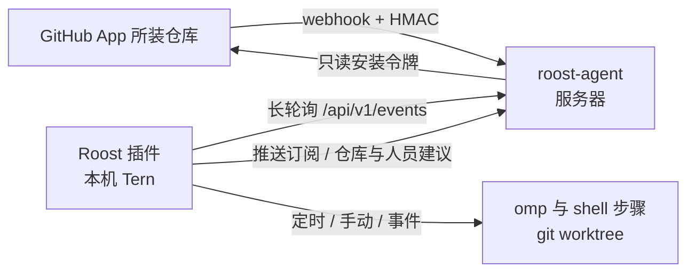

# Roost

[English](README.md)

Roost 是一个 Tern 插件形式的本地自动化工作台:在**本机**按固定流程运行 omp。新建和编辑自动化的方式对标 grok.com/automations:在面板里点「新建自动化」或从模板开始,用表单选触发器、写指令,保存即生效。触发方式有两种:

- **主动**:定时,包括一次、每小时、每天、每周、每月、每年和自定义 cron,由插件在本机调度,无需服务器;也可以在面板上手动运行,可带输入参数。
- **被动**:GitHub 事件,如 PR 打开/推送/合并、评论、审查、标签、分支推送、CI 完成等。GitHub 无法直接访问本机,所以服务器上放一个小型**中继** `roost-agent`(Rust)。它以 **GitHub App** 的身份接收所装仓库的 webhook,验签、按订阅过滤并缓存,本机插件长轮询拉取。

`roost-agent` 不运行任何工作流,也不是 AI 运行时;它只是事件中继节点。



## 安装插件

```sh
tern plugin install github.com/<owner>/<repo>    # 或开发时:tern plugin link .
```

命令面板运行 **Roost:打开工作台**。首次启动会在 `tern.plugin.data`(macOS:`~/Library/Application Support/Tern/plugin-data/roost/`)生成两个文件,保存即生效:

| 文件 | 作用 |
|---|---|
| `roost.toml` | 本机绑定:中继地址与令牌、runner 设置(omp 参数、agent 会话名、并发、超时、PATH)、`[github] login`(可选,你的 GitHub 用户名) |
| `workflows.toml` | 仓库(GitHub 名 → 本机路径)、自动化、触发器、步骤;面板的表单编辑器读写的就是它 |
| `theme.css`(可选) | 自定义样式,实时注入,见「外观定制」 |

### 在面板中新建自动化

「工作流」页的「新建自动化」会打开一个表单,也可以从下方的模板库开始。表单内容:

- **名称与图标**。
- **触发器**:点「＋添加触发器」,菜单按「定时」和「GitHub」分组。
  - 定时触发器显示成一句话,例如「每周 ▾ 在 一 三 五 于 09:00」「每小时 ▾ 在 工作日 9:00–18:00 之间」。
  - GitHub 触发器显示成一张卡片,列出该种类支持的筛选器,空着表示「任意」。仓库、作者、负责人、标签、分支、工作流名称这几项会通过 GitHub App 给出建议。
  - 每个 GitHub 触发器至少要设一个筛选器。
- **指令**:即 omp 提示词,可以选模型;另外可以追加更多 omp 或 shell 步骤。
- **通知**:运行结束时在 Tern 弹出通知。
- **高级**:id、并发、工作区、超时、时区、外部贡献者与 fork 的放行。

保存时整份文件用同一套校验规则检查。只有这一条自动化对应的 `[[workflow]]` 块会被替换,文件里的其他内容和注释保持不变,旧文件备份为 `workflows.toml.bak`。

### workflows.toml

```toml
[repos."acme/web"]
path = "~/code/web"     # 可选:本机检出;没声明的仓库在临时目录中运行
branch = "main"         # 定时/手动运行检出的分支
worktree = true         # 运行在临时 git worktree 中(默认);false 则直接用 path

[[workflow]]
id = "pr-review"
name = "PR 审查"
icon = "eye"
notify = true           # 运行结束时弹出通知(默认)
concurrency = "queue"   # queue | skip | replace
timeout = "20m"

[[workflow.trigger]]    # GitHub(经中继)
github = "pr_opened"
repos = ["acme/web"]    # 支持 owner/*
authors = ["@me"]       # @me = 你自己

[[workflow.trigger]]    # 定时;默认本机时区,tz = "UTC" 可选
schedule = "weekly"
days = ["mon", "wed", "fri"]
time = "09:00"

[[workflow.step]]
omp = """
审查 {{repo}} 的 PR #{{number}}:{{title}}

{{url}}
"""
```

**定时**(`schedule`):

| 值 | 参数 |
|---|---|
| `once` | `at = "2026-11-06 08:30"`;错过时一小时内补跑一次 |
| `hourly` | `days`(可空 = 每天)、`between = ["09:00", "18:00"]`(整点,省略 = 全天),每个整点触发 |
| `daily` | `time` |
| `weekly` | `days`(`sun`…`sat`,至少一天)、`time` |
| `monthly` | `day`(1–31,没有这天的月份跳过)、`time` |
| `yearly` | `date = "MM-DD"`、`time` |
| `cron` | `cron = "0 9 * * 1-5"` |

所有定时都可以加 `tz`、`repo`(在哪个本机检出中运行)、`ref`。

**GitHub**(`github`,各种类只接受下表列出的筛选器):

| 值 | 何时触发 | 筛选器 |
|---|---|---|
| `pr_opened` | PR 打开(非草稿)或标记为可审查 | repos authors |
| `pr_draft` | PR 以草稿打开或转为草稿 | repos authors |
| `pr_pushed` | 新提交推送到 PR | repos authors skip_drafts |
| `pr_merged` | PR 合并 | repos authors include_closed |
| `comment` | PR 或议题上有新评论 | repos authors assignees comment ignore_bots ignore_self |
| `push` | 提交推送到分支 | repos authors branches |
| `label` | PR 或议题的标签被添加或移除 | repos authors assignees label_actions labels |
| `check_completed` | 检查套件完成 | repos authors conclusions forks |
| `issue_comment` | 纯议题(非 PR)上有新评论 | repos authors assignees comment ignore_bots ignore_self |
| `review_comment` | PR 上有新的审查评论 | repos authors assignees comment ignore_bots ignore_self |
| `review` | PR 审查提交 | repos authors assignees review_states ignore_bots ignore_self |
| `review_thread` | 审查线程被解决或重新打开 | repos authors thread_actions |
| `workflow_run` | Actions 工作流运行完成 | repos authors branches conclusions workflows forks |
| `issue_opened` | 新议题创建 | repos authors labels ignore_bots |
| `event` | 任意事件(`event = "release"`) | repos authors actions branches labels comment |

- 列表筛选器之间是「且」,同一个列表里的多个值是「或」,空着表示任意。
- 「作者」的含义:评论、审查事件里是写评论或审查的人,PR、议题事件里是 PR 或议题的作者,push 事件里是推送者。
- 开关项及默认值:`skip_drafts` 默认开,`include_closed` 默认关,`ignore_bots` 默认开,`ignore_self` 默认开。`ignore_self` 忽略你自己的活动,前提是 `roost.toml` 设了 `[github] login`,或者 App 归你个人所有;把自己(`@me`)写进 `authors` 就会放行你自己的活动。
- **安全默认值**:议题、评论、PR 这类「用户可写内容」事件,默认只接受 `OWNER`/`MEMBER`/`COLLABORATOR` 作者;设 `associations = ["*"]`(表单「高级」里的「允许外部贡献者」)才对所有人开放。`check_completed`/`workflow_run` 默认拒绝代码来自 fork(或无法确认来源)的事件,设 `forks = true` 才接受。omp 以 yolo 模式运行,放开前请想清楚提示词注入与执行外部代码的风险。
- **模板**只用于 omp 提示词:`{{repo}} {{event}} {{action}} {{number}} {{title}} {{body}} {{url}} {{ref}} {{sha}} {{branch}} {{sender}} {{comment}} {{label}} {{workflow}} {{run_id}} {{trigger}} {{input.<名>}} {{payload.<路径>}}`(数组下标从 0 开始)。shell 步骤不做模板替换,改读环境变量 `ROOST_*`:`ROOST_REPO`、`ROOST_NUMBER`、`ROOST_SHA`、`ROOST_BRANCH`、`ROOST_SENDER`、`ROOST_URL`、`ROOST_EVENT_PATH`(完整 payload)、`ROOST_INFO_PATH`(归一化事件)、`ROOST_WORKSPACE`、`ROOST_INPUT_<名>` 等,事件文本不会被拼进命令行。
- **工作区**:在 `[repos]` 里声明了本机路径的仓库,事件运行在 `plugin-data/roost/worktrees/<run>` 的临时 worktree 中(检出 PR 的 `refs/pull/N/head`、push 的 sha 等),结束后自动清理;`workspace = "repo" | "temp"` 可改。没声明的仓库在临时空目录中运行。
- 取消或超时时,shell 步骤会向整个进程组发送 SIGTERM,8 秒后 SIGKILL;omp 步骤直接关闭它的 agent 标签页。插件重载时,仍在运行的步骤会被重新接管。

### omp 步骤与会话侧栏

- omp 步骤以 **Tern 原生 agent block** 运行。Tern 窗口在固定会话(`roost.toml` 的 `[runner] session`,默认 `Roost`,不存在时自动创建)里新开一个标签页执行。打开时不会抢走焦点。这一轮结束后标签页自动关闭,成功或失败都会关;如果被人手动关掉,这一步按失败处理。agent 的最后一条回复会追加到运行日志。
- agent 只能由窗口打开:插件 host 把任务写进运行目录和 kv,所有窗口用 `mkdir` 认领,保证只有一个窗口去打开。**没有打开的 Tern 窗口时,omp 步骤会一直等待,直到有窗口出现或超时**。agent 已经打开后如果所有窗口都关了,取消和超时要等有窗口重新打开后才会关掉它。
- omp 以交互式运行,会话保存在运行目录 `runs/<run>/s<步骤>.session/`(`--session-dir`),不会写入 `~/.omp`。这些会话随 `keep_runs` 跟运行一起清理。`-p`、`--session-dir`、`--resume`、`--continue` 等参数由 Roost 管理,写进 `omp_args` 或步骤 `args` 会报配置错误。
- omp 步骤收不到 `[runner] env`、工作流 `env` 以及 `ROOST_*` 环境变量,环境沿用 Tern 打开 agent 时的环境。需要的信息请通过提示词模板传入。
- **会话侧栏**:命令面板运行 **Roost:会话侧栏**,或点工作台标题栏的 omp 图标,会在当前标签页左侧打开或关闭 `roost.sessions` 分屏,列出 Roost 跑过的 omp 会话。双击某行或按 Enter:还在运行的会话会跳到它的标签页;已结束的会话会在新标签页中用 `omp --resume` 继续打开。运行详情里的「omp 会话」按钮效果相同。

## 部署中继 roost-agent

```sh
cd agent && cargo build --release          # 产物在 /tmp/roost-cargo-target/release/roost-agent
scp /tmp/roost-cargo-target/release/roost-agent server:/usr/local/bin/
```

服务器上:

1. `agent/deploy/agent.example.toml` → `/etc/roost/agent.toml`(权限 600)。管理令牌写成 `env:NAME` 或 `file:/path`,并放进 `/etc/roost/env`:`ROOST_TOKEN=$(openssl rand -hex 24)`。
2. 在 TLS 反向代理(Caddy/Nginx)后暴露 `listen`,把 `server.public_url` 设为公网地址(GitHub 要用它回调和投递 webhook)。
3. `agent/deploy/roost-agent.service` → `/etc/systemd/system/`,`systemctl enable --now roost-agent`。
4. `roost-agent check --config /etc/roost/agent.toml` 校验配置。

本机 `roost.toml`:

```toml
[relay]
url = "https://roost.example.com"
token = "<ROOST_TOKEN 的值>"   # 或 token_env = "ROOST_TOKEN"
```

### 创建 GitHub App

中继以 GitHub App 的身份工作,不需要个人令牌,也不用逐个仓库配置 webhook:

1. Roost「中继」页点「创建 GitHub App」。要建在组织下,先填组织名。
2. 浏览器打开中继的页面,页面会自动把 App 清单提交给 GitHub。GitHub 显示确认页,名称可以改,确认后点创建。
3. GitHub 回调中继。中继把 App 的 id、私钥和 webhook 密钥保存到 `<data>/github-app.json`(权限 600),然后跳转到安装页。在安装页选择要安装的仓库。
4. 以后要增减仓库,在 GitHub 的 App 安装设置里修改。

App 只申请**只读**权限:metadata、contents、issues、pull_requests、checks、actions。中继用它接收事件,并给表单提供仓库、人员、标签、分支、工作流名称的建议。需要写 GitHub 的动作(评论、审查、推送)由 omp 或 shell 步骤用你本机的 `gh` 身份完成。「忘记本地凭据」只删除中继上的凭据,App 本身要到 GitHub 设置里删除。

### 配置同步与回退

- **本地优先**:保存 `workflows.toml` 后,插件计算每个仓库需要的事件,推送到中继(`PUT /api/v1/subscriptions`,带版本号防覆盖)。仓库筛选为空的触发器订阅在 `"*"`(任意仓库)下。中继只保留订阅了的事件。
- **回退到云端手动设置**:推送失败时,「中继」页给出完整的 `subscriptions.toml` 内容可复制;保存到服务器后点「重新加载」(或 `systemctl reload roost-agent`)。
- 服务器上手改过订阅后,本机再推送会提示冲突:可「以本地覆盖」或「采用云端」。
- **远程重启**:`agent.toml` 改动(或换了二进制)后,点「重启中继」即可,无需登录服务器。中继原地 `exec` 自身(PID 不变),已缓存的事件与游标保留。

### 中继 API

除 `/healthz`、`/hooks/github` 和 `/github/app/*` 页面外,都需要 `Authorization: Bearer <token>`。

| 方法 | 路径 | 说明 |
|---|---|---|
| POST | `/hooks/github` | GitHub App webhook(用 App 的密钥验证 `X-Hub-Signature-256`) |
| GET | `/api/v1/events?after=&wait=&limit=` | 拉取事件,`wait` 秒长轮询(≤30) |
| GET/PUT | `/api/v1/subscriptions` | 读取/推送订阅(`base_revision` 不符返回 409) |
| POST | `/api/v1/reload` | 重新读取 `subscriptions.toml`(SIGHUP 同效) |
| POST | `/api/v1/restart` | 原地重启 |
| POST | `/api/v1/github/app/manifest` | 开始创建 App(`{"org"?, "name"?}`),返回要在浏览器打开的地址 |
| DELETE | `/api/v1/github/app` | 删除本地 App 凭据 |
| GET | `/api/v1/github/{repos,people,labels,branches,workflows}?repo=` | 表单建议 |
| POST | `/api/v1/events/test` | 产生一条 `roost_test` 事件,验证全链路 |
| GET | `/api/v1/status`、`/api/v1/deliveries` | 状态(含 App 信息)、最近投递记录 |
| GET | `/github/app/new`、`/github/app/callback`、`/github/app/installed` | App 注册流程的浏览器页面 |

## 外观定制

面板全部由 Tern 原生元素绘制(表格、分栏、ANSI 日志、状态徽章),视图按节点 key 增量更新,日志只发送追加部分。`roost.css` 顶部列出了所有 `data-role` 钩子;在 `plugin-data/roost/theme.css` 中写样式即可覆盖,保存后实时生效,插件目录不会被改动。

## 开发

```sh
tern plugin link .
scripts/check.sh            # luau-lsp 严格检查、Luau 测试、cargo fmt/clippy/test、记忆预算
python3 tests/run.py        # 只跑 Luau 测试
```
